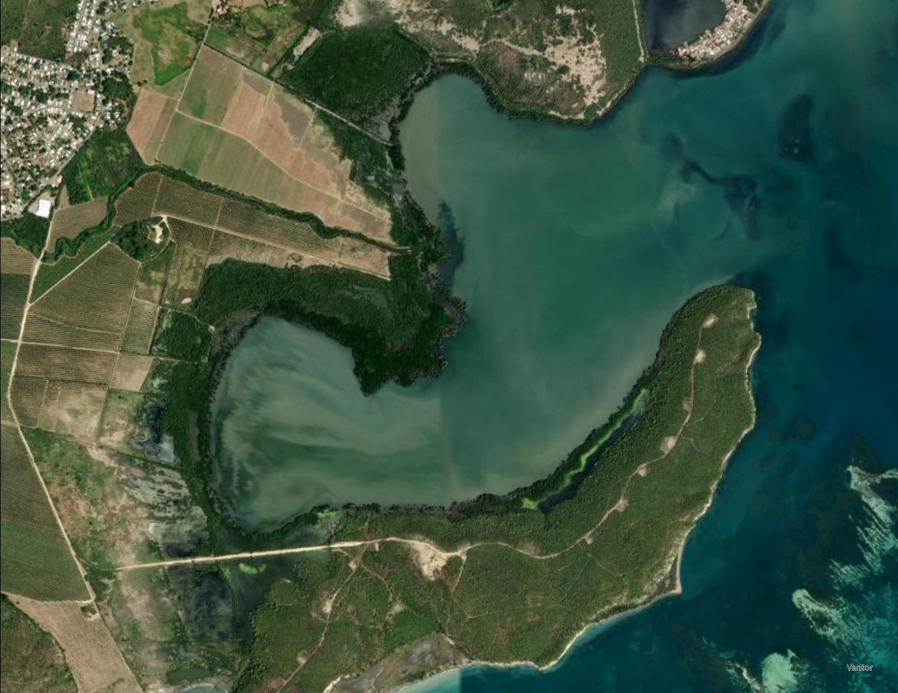
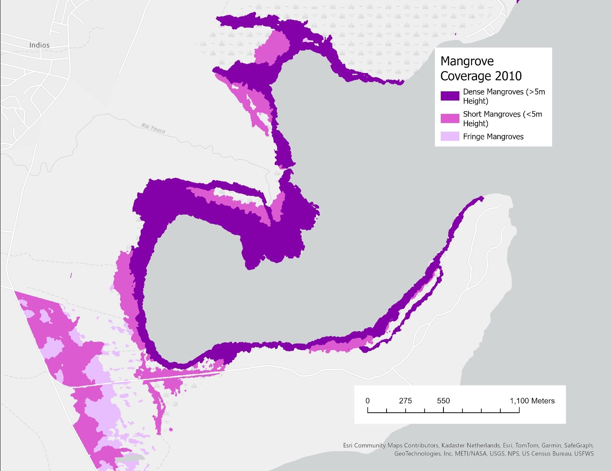
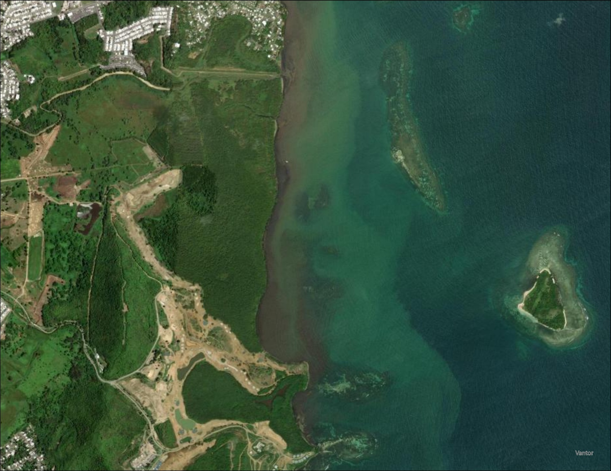
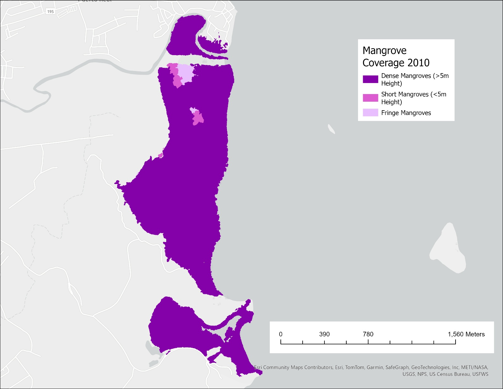
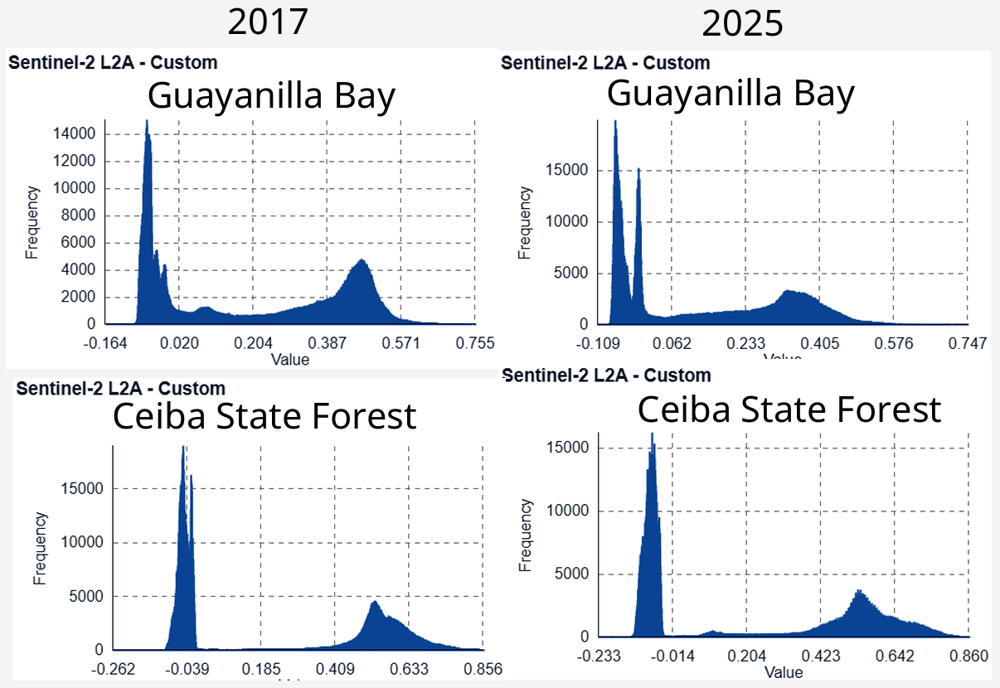

# Mangrove Fragmentation and Post-Hurricane Recovery, Puerto Rico

A decade of Sentinel-2 imagery compared against two coastal mangrove sites that took the same storm and recovered completely differently.

**The finding:** Ceiba State Forest — contiguous, 500 m deep, on an open Atlantic coastline — absorbed the stronger half of Hurricane Maria and returned to pre-storm vegetation levels within three years, exceeding them by 2025. Guayanilla Bay — a thin fringe no more than 200 m wide inside a semi-enclosed harbor — took the weaker half and has deteriorated continuously since 2017, with some areas showing complete loss by early 2022. Spatial configuration predicted recovery better than storm intensity did.

Independent research, GEOG441, University of Maryland, Spring 2026. Solo project.

---

## Why this question

Hurricane Maria made landfall on southeastern Puerto Rico on 20 September 2017 as a Category 4 storm, with peak recorded winds near 135 kt and daily rainfall exceeding 800 mm at some locations — the largest maximum daily rainfall of 129 storms to affect the island since 1956. Storm surge reached 6–9 ft above ground level along the Ceiba municipalities.

Mangroves are a first line of coastal defense: their trunks, roots, and leaves impose physical drag on wave energy, and their root systems drive sediment accretion that resists erosion. Existing work establishes that mangrove loss is associated with fragmentation, and separately that recovery varies by geomorphology, species, and size. What has not been well studied is the intersection — whether fragmentation itself governs how quickly a mangrove forest recovers from a tropical cyclone.

**Does spatial fragmentation predict post-storm recovery time in mangrove forests?**

## Study sites

Two sites were chosen for contrasting structure under comparable storm exposure.

| | Guayanilla Bay | Ceiba State Forest |
|---|---|---|
| Location | 18°N, −66.76°W (south coast) | 18.20°N, −65.55°W (northeast coast) |
| Setting | Semi-enclosed shallow bay, hook-shaped peninsula | Open coastline facing the Atlantic |
| Mangrove extent | Thin strip, ≤200 m inland at widest | 350+ acres (130–180 ha), avg. 500 m inland, up to 800 m |
| Structure | Fragmented; short fringe vegetation, gaps | Contiguous, high canopy, biomass to 245 t/ha |
| Species | Mixed | *Rhizophora mangle*, *Avicennia germinans*, *Laguncularia racemosa* |
| Storm exposure | Lower surge | Higher surge (6–9 ft), stronger winds |

*Guayanilla Bay. Dense mangrove appears as dark green along the center coast; shorter fringe mangrove as lighter green 50–150 m inland. Basemap: Esri, DigitalGlobe, GeoEye, i-cubed, USDA FSA, USGS, AEX, Getmapping, Aerogrid, IGN, IGP, swisstopo, and the GIS User Community.*

*NOAA C-CAP 30 m land cover, Guayanilla Bay, 2010. Dense mangrove >5 m in dark purple; short mangrove <5 m in pink; fringe and shrub mangrove in light pink. The fragmentation is visible in the discontinuity of the purple.*

*Ceiba State Forest, center of frame — dense dark green, bordered by barren soil to the west and the Atlantic to the east.*

*NOAA C-CAP, Ceiba State Forest. Almost exclusively dense high-canopy mangrove (dark purple), with fringe/shrub areas (pink) confined to the north.*

## Data

| Dataset | Coverage | Role |
|---|---|---|
| Sentinel-2 L2A (Copernicus/ESA, via ASF DAAC) | 2016–2026 | EVI2 and Barren Soil Script; primary change signal |
| NOAA C-CAP high-resolution land cover | 2010–2017, 10 m | Pre-storm mangrove baseline |
| ALOS-2 / Global Mangrove Watch (JAXA) | 2007–2020 | Independent pre- and post-storm mangrove extent |

Post-storm C-CAP was not available for Puerto Rico, so C-CAP serves as the pre-storm baseline only and the change detection rests on Sentinel-2.

Three C-CAP classes were extracted: Estuarine Forested Wetland (woody vegetation >5 m), Estuarine Scrub Wetland (woody vegetation <5 m), and Estuarine Emergent Wetland (rooted hydrophytes, >80% cover).

## Method

**EVI2 (Enhanced Vegetation Index 2)** was used rather than NDVI. NDVI saturates in dense canopy, which is exactly the condition at Ceiba; EVI2 holds its dynamic range across dense tropical cover and discriminates better among discrete land cover classes (Mondal, 2010).

**Barren Soil Script (BSS)**, a modification of the Bare Soil Index with NIR (B08) on the green channel and SWIR (B11) on the red, renders vegetation green, water black, and barren ground red — used to corroborate habitat loss and erosion independently of the vegetation index.

**Seasonality control:** both indices vary seasonally, so all observations were taken at the same annual point across the study period.

Processing was done in ArcGIS Pro, with Sentinel-2 L2A scenes retrieved from ASF DAAC.

## Results

*EVI2 pixel value distributions at both sites, 2017 and 2025. Copernicus Sentinel data 2017–2025, processed by ESA, retrieved from ASF DAAC.*

**Ceiba State Forest** returned to pre-storm EVI2 values by 2020, and by 2025 parts of the reserve exceeded them. The 2025 distribution shows the vegetation mode shifted toward higher EVI2 values with a broader high-value tail — denser canopy than before the storm. JAXA mangrove rasters and Sentinel-2 imagery independently confirm initial loss followed by recovery across the reserve.

**Guayanilla Bay** shows continuous annual deterioration from 2017 through 2025, with some regions at complete loss by early 2022. The 2025 distribution shows the vegetation mode both reduced in magnitude and shifted lower, while low-end mass increases. BSS and Sentinel-2 imagery confirm increasing barren ground exposure along the coastline.

The asymmetry is the point: **Ceiba took the stronger storm and recovered; Guayanilla took the weaker storm and did not.**

### Mechanism

Contiguous forest at Ceiba provides interior structure that supports seed regeneration and nutrient retention, and its depth inland buffers the interior from edge effects. Guayanilla's thin fragmented strip has almost no interior — nearly all of it is edge — which limits the nutrient and sediment delivery regrowth depends on.

### Confounder

A magnitude 5.8 earthquake struck near Guayanilla in 2020 and may have compounded degradation there. However, the deterioration trend is clearly established in the 2017–2019 data, before the earthquake, so it cannot be the primary driver.

## Conclusion

Fragmented mangrove forests show substantially slower post-storm recovery than contiguous ones. Patch size, inland extent, and geomorphology appear to be stronger predictors of resilience than storm intensity alone. For coastal management, that argues for prioritizing protection of contiguous mangrove habitat and expanding protection in already-fragmented areas, where recovery cannot be assumed.

## Limitations

- **Two sites.** This is a paired comparison, not a sample. The sites differ in more than fragmentation — coastline orientation, enclosure, species composition, and protection status all vary, and none of those are controlled. The conclusion is a well-supported hypothesis, not a demonstrated general law.
- **No post-storm C-CAP.** Mangrove extent after 2017 is inferred from spectral indices rather than measured by a classified land cover product.
- **Histogram axes are not normalized** between panels in the results figure, which makes the visual comparison harder than it needs to be and invites misreading of relative magnitudes.
- **Seasonality control is same-date, not atmospherically matched.** Cloud and aerosol conditions on the chosen dates were not harmonized.
- **The 5.8 earthquake** is addressed above but not quantitatively separated from the storm signal.

## What I'd do differently

Normalize the EVI2 distributions to a common axis and plot the full annual series rather than endpoints — the 2017-to-2025 comparison carries the result, but the year-by-year trajectory is what actually demonstrates "recovered by 2020" and it deserves to be shown rather than stated. Beyond that: expand to a larger set of paired sites across the Caribbean to turn a two-site contrast into something testable, and quantify fragmentation explicitly with landscape metrics (patch size distribution, edge-to-interior ratio, nearest-neighbor distance) instead of treating it as a categorical property of each site.

## Full paper

[Sheppard (2026), *Using Sentinel-2 Data to Analyze Mangrove Fragmentation and Recovery Time Following Hurricane Maria in Puerto Rico*](paper/Sheppard_2026_Mangrove_Fragmentation_Recovery_Puerto_Rico.pdf) — includes complete literature review and references.

## Data sources

- Copernicus Sentinel-2 L2A, European Space Agency, retrieved via [ASF DAAC](https://www.asf.alaska.edu/)
- [NOAA C-CAP Regional Land Cover](https://coast.noaa.gov/digitalcoast/data/), Office for Coastal Management
- [ALOS-2 Global Mangrove Watch](https://www.eorc.jaxa.jp/ALOS/en/dataset/gmw_e.htm), JAXA Earth Observation Research Center
- Storm surge figure: National Hurricane Center Storm Surge Unit, NOAA
